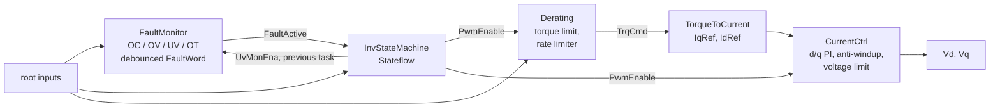

# InvCtrl - inverter control, model-based development

`InvCtrl` is the application software component of a traction inverter that drives a
permanent-magnet synchronous motor (PMSM): operating state machine, fault monitoring,
torque derating, torque-to-current conversion and d/q current control. It is developed
model-based in MATLAB, Simulink and Stateflow and verified by model-in-the-loop (MIL)
tests in CI.

## Model as code

The Simulink model is **generated** from MATLAB scripts in `model/`. The scripts are the
single source of truth; `InvCtrl.slx` is a build artefact (`work/InvCtrl.slx`, not
version controlled). Every design change - a block, a wire, a Stateflow transition, a
calibration value - is a change to a text file, reviewed as a normal diff and verified
by CI before it is merged.



Single rate, discrete fixed-step solver, **Ts = 100 us** (10 kHz).

| Component | Built by | Content | Requirements |
|---|---|---|---|
| `InvStateMachine` | `model/components/add_state_machine.m` | Stateflow chart OFF -> STANDBY -> PRECHARGE -> READY -> RUN, SAFE_DISCHARGE, latched FAULT with fault reset; outputs `InvState`, `PwmEnable`, `UvMonEna` | REQ-INV-001..011 |
| `Derating` | `model/components/add_derating.m` | torque limit = min of peak torque and three 1-D tables (inverter temperature, motor temperature, DC-link voltage), saturation, rate limiter, zero torque outside RUN | REQ-INV-012..017 |
| `TorqueToCurrent` | `model/components/add_torque_to_current.m` | IqRef = TrqCmd / Kt, IdRef from the field-weakening table | REQ-INV-018, 019 |
| `CurrentCtrl` | `model/components/add_current_ctrl.m` | d/q PI controllers with clamping anti-windup, voltage vector limit Udc/sqrt(3) with d-axis priority, reset while PWM is off | REQ-INV-020..023 |
| `FaultMonitor` | `model/components/add_fault_monitor.m` | overcurrent, DC-link over/undervoltage, inverter and motor over-temperature, each with a debounce counter; FaultWord bit field | REQ-INV-024..029 |

Interface, units and all requirements: [`docs/REQUIREMENTS.md`](docs/REQUIREMENTS.md).

## Repository layout

| Path | Content |
|---|---|
| `model/build_inv_ctrl.m` | builds the model: solver settings, root ports, parameters, top-level wiring |
| `model/components/` | one build function per subsystem / chart |
| `model/util/` | small helpers (`mbd_add`, `mbd_line`, `mbd_pos`) |
| `model/InvState_T.m` | enumeration of the operating states |
| `params/inv_ctrl_params.m` | all design and calibration parameters (stored in the model workspace) |
| `tests/` | `matlab.unittest` MIL test classes, one per component |
| `tests/support/` | shared fixture (builds the model once per run), test base class, scenario builder |
| `scripts/run_mil_tests.m` | CI entry point: build, run all tests, JUnit XML, job summary, plots |
| `scripts/inv_ctrl_setup.m` | MATLAB path and Simulink cache folder setup |
| `.github/workflows/mil-tests.yml` | CI workflow |

## Running locally

Requires MATLAB R2025a or newer with Simulink and Stateflow.

```matlab
cd <repository root>
addpath('scripts')
run_mil_tests                 % build the model and run the full MIL suite

inv_ctrl_setup                % or: build the model and open it
build_inv_ctrl
open_system('work/InvCtrl.slx')
```

To run single tests: `inv_ctrl_setup; addpath('tests'); runtests('StateMachineTest')`.

## Tests

- Every test class uses a shared fixture that builds `InvCtrl` from the scripts, so CI
  always tests exactly what is in the commit.
- Each test builds a stimulus with `InvCtrlScenario` on top of a standard power-up
  sequence (STANDBY at 10 ms, PRECHARGE at 20 ms, READY at 65 ms, RUN at 80 ms),
  simulates with `Simulink.SimulationInput` and checks the requirement with explicit
  tolerances. Test methods are tagged with the requirement IDs.
- The current controller is tested open loop: the measured currents are test inputs.
- Expected values come from `docs/REQUIREMENTS.md`, not from the parameter file, so a
  wrong calibration is detected.
- Output: `results/junit_mil.xml`, `results/SUMMARY.md`, `results/plots/*.png`.

## CI

`.github/workflows/mil-tests.yml` runs on every push to every branch (and on demand):

1. MATLAB, Simulink and Stateflow are installed on a GitHub-hosted Ubuntu runner with
   `matlab-actions/setup-matlab`;
2. `run_mil_tests` builds the model and runs the MIL suite; the job fails if any test fails;
3. the job summary shows the result per test with its requirement IDs and the first
   failure message;
4. the artifact `mil-results` contains the JUnit XML, the summary, the plots and the
   generated `InvCtrl.slx`.

## Modelling guidelines

- All signals carry their unit in the name (`_Nm`, `_A`, `_V`, `_degC`, `_radps`);
  parameters too (`_tk` = task cycles).
- No literal calibration values in blocks or charts: every value is a parameter in
  `params/inv_ctrl_params.m`.
- Floating-point signals are `single`; flags are `boolean`; FaultWord is `uint16`.
- Stateflow charts use C as the action language. Timing in states uses temporal logic
  (`after(n, tick)`); edge-triggered requests use the change detection operators
  (`hasChanged`, `hasChangedTo`, `hasChangedFrom`).
- Transition priorities are explicit; the fault reaction is always priority 1.
- Every requirement has at least one MIL test; a behaviour change updates the
  requirement, the model and the test in the same change.

## Working on a change

1. Create a branch named after the ticket (for example `KEY-123-short-description`).
2. Change the scripted model in `model/` and/or the parameters in `params/`; add or
   update the MIL test that covers the requirement.
3. Push the branch. CI builds the model and runs the full MIL suite on the branch.
4. Open a pull request; it is merged when CI is green and the diff is reviewed.
