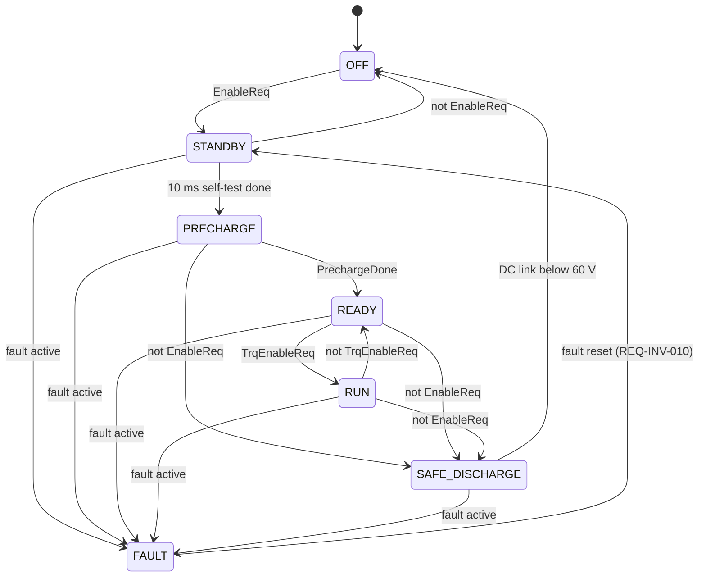

# InvCtrl - software requirements

Inverter control application for a permanent-magnet synchronous motor (PMSM)
traction drive. Single-rate application with a task period of **Ts = 100 us**
(10 kHz); "task" below means one execution of the model. Units: N*m, A, V, degC,
rad/s (mechanical speed). Parameter values live in `params/inv_ctrl_params.m`.

Every requirement is verified by at least one MIL test in `tests/`. Test methods
carry the requirement IDs as test tags, and the CI job summary lists them per test.

## Interface

| Input | Type | Unit | Description |
|---|---|---|---|
| EnableReq | boolean | - | inverter enable request from the vehicle control unit (VCU) |
| TrqEnableReq | boolean | - | torque enable request (VCU) |
| FaultReset | boolean | - | fault reset request (VCU) |
| PrechargeDone | boolean | - | DC-link precharge completed (HV system) |
| TrqReq_Nm | single | N*m | torque request |
| MotSpd_radps | single | rad/s | mechanical rotor speed |
| DcLinkVolt_V | single | V | DC-link voltage |
| InvTemp_degC | single | degC | inverter power module temperature |
| MotTemp_degC | single | degC | motor winding temperature |
| PhaseCurr_A | single[3] | A | measured phase currents a, b, c |
| Id_A, Iq_A | single | A | measured d/q currents |

| Output | Type | Unit | Description |
|---|---|---|---|
| InvState | InvState_T | - | OFF=0, STANDBY=1, PRECHARGE=2, READY=3, RUN=4, SAFE_DISCHARGE=5, FAULT=6 |
| PwmEnable | boolean | - | gate driver PWM enable |
| TrqCmd_Nm | single | N*m | torque command after limitation and rate limiting |
| TrqLim_Nm | single | N*m | active torque limit |
| IdRef_A, IqRef_A | single | A | current references |
| Vd_V, Vq_V | single | V | voltage commands to the modulator |
| FaultWord | uint16 | - | bit 0 OC, 1 OV, 2 UV, 3 OT_INV, 4 OT_MOT |

## State machine (InvStateMachine)

## Requirements

| ID | Title | Requirement | Verified by |
|---|---|---|---|
| REQ-INV-001 | Power-up state | After power-up InvState shall be OFF and PwmEnable FALSE. | StateMachineTest/testNominalStartupSequence |
| REQ-INV-002 | Enable | OFF -> STANDBY in the task in which EnableReq is TRUE. | StateMachineTest/testNominalStartupSequence |
| REQ-INV-003 | Standby self-test | STANDBY -> PRECHARGE after a self-test time of 10 ms (100 tasks) in STANDBY; STANDBY -> OFF when EnableReq becomes FALSE. | StateMachineTest/testNominalStartupSequence |
| REQ-INV-004 | Precharge | PRECHARGE -> READY when PrechargeDone is TRUE. | StateMachineTest/testNominalStartupSequence |
| REQ-INV-005 | Torque enable | READY -> RUN when TrqEnableReq is TRUE; RUN -> READY when TrqEnableReq becomes FALSE. | StateMachineTest/testNominalStartupSequence, testTorqueDisableReturnsToReady |
| REQ-INV-006 | Disable | PRECHARGE, READY or RUN -> SAFE_DISCHARGE when EnableReq becomes FALSE. | StateMachineTest/testDisableDischargesThenOff |
| REQ-INV-007 | Discharge complete | SAFE_DISCHARGE -> OFF when DcLinkVolt_V < 60 V. | StateMachineTest/testDisableDischargesThenOff |
| REQ-INV-008 | Fault reaction | From STANDBY, PRECHARGE, READY, RUN or SAFE_DISCHARGE the state shall change to FAULT in the task in which a fault is active (FaultWord != 0). The fault reaction has priority over all other transitions. | StateMachineTest/testFaultLatchedUntilReset, FaultMonitorTest/testOvercurrentDetection, testUndervoltageOnlyWhenHvActive |
| REQ-INV-009 | Fault latching | The FAULT state shall persist after the fault condition has disappeared until a fault reset according to REQ-INV-010. | StateMachineTest/testFaultLatchedUntilReset |
| REQ-INV-010 | Fault reset | FAULT -> STANDBY only on a rising edge (FALSE -> TRUE) of FaultReset that occurs while no fault is active. A FaultReset that is held TRUE, or that rose while the fault was still active, shall not release FAULT. | StateMachineTest/testFaultLatchedUntilReset, testFaultResetRequiresRisingEdge |
| REQ-INV-011 | PWM enable | PwmEnable shall be TRUE if and only if InvState is RUN. | StateMachineTest/testNominalStartupSequence, testTorqueDisableReturnsToReady |
| REQ-INV-012 | Torque limit | TrqLim_Nm = min(350 N*m, f_InvTemp, f_MotTemp, f_Udc); \|TrqCmd_Nm\| shall never exceed TrqLim_Nm. | DeratingTest (all table tests) |
| REQ-INV-013 | Inverter temperature derating | f_InvTemp [degC -> N*m]: -40 -> 350, 80 -> 350, 90 -> 300, 100 -> 200, 110 -> 100, 120 -> 0; linear interpolation, clipped outside; tolerance 1 N*m. | DeratingTest/testInverterTempDerating |
| REQ-INV-014 | Motor temperature derating | f_MotTemp [degC -> N*m]: -40 -> 350, 140 -> 350, 150 -> 300, 160 -> 200, 170 -> 100, 180 -> 0; linear, clipped; tolerance 1 N*m. | DeratingTest/testMotorTempDerating |
| REQ-INV-015 | DC-link voltage derating | f_Udc [V -> N*m]: 400 -> 0, 450 -> 0, 550 -> 350, 850 -> 350, 900 -> 0, 950 -> 0; linear, clipped; tolerance 1 N*m. | DeratingTest/testDcLinkVoltageDerating |
| REQ-INV-016 | Torque rate limit | \|TrqCmd_Nm(k) - TrqCmd_Nm(k-1)\| <= 1 N*m per task (10 kN*m/s). | DeratingTest/testTorqueRateLimit |
| REQ-INV-017 | Zero torque outside RUN | TrqCmd_Nm = 0 whenever InvState is not RUN; on entry into RUN the torque command shall start from 0 (no step). | DeratingTest/testTorqueZeroOutsideRun |
| REQ-INV-018 | Torque to current | IqRef_A = TrqCmd_Nm / Kt with Kt = 0.5 N*m/A; error <= 0.1 A. | TorqueToCurrentTest/testIqRefScaling |
| REQ-INV-019 | Field weakening | IdRef_A from \|MotSpd_radps\| [rad/s -> A]: 0..500 -> 0, 600 -> -80, 700 -> -160, 800 -> -240, 1000 -> -360, 1200 -> -450; linear, clipped; tolerance 0.5 A. | TorqueToCurrentTest/testFieldWeakeningIdRef |
| REQ-INV-020 | PI current control | Per axis: V = Kp * e + I, I(k) = I(k-1) + KiTs * e(k) (parallel PI, forward Euler, e = reference - measurement) with Kp = 0.6283 V/A and KiTs = 0.003016 V/A per task. | CurrentCtrlTest/testPiResponseOpenLoop |
| REQ-INV-021 | Anti-windup | While an output is held at its voltage limit, its integrator shall not wind up: when the error changes sign, the output shall leave the limit within 1 task and then decrease in every task. | CurrentCtrlTest/testAntiWindupRecovery |
| REQ-INV-022 | Voltage limit | sqrt(Vd_V^2 + Vq_V^2) <= DcLinkVolt_V / sqrt(3) in every task, with d-axis priority (Vd within +/-Vmax, Vq within the remaining headroom). | CurrentCtrlTest/testVoltageVectorLimit |
| REQ-INV-023 | Controller reset | While PwmEnable is FALSE the integrators shall be reset and Vd_V = Vq_V = 0. | CurrentCtrlTest/testOutputsZeroWhenPwmDisabled |
| REQ-INV-024 | No spurious faults | With nominal inputs no fault shall be reported, from the first task after power-up on. | FaultMonitorTest/testNoSpuriousFaultAtStartup |
| REQ-INV-025 | Overcurrent | max \|PhaseCurr_A\| > 900 A for 5 consecutive tasks (0.5 ms) shall set FaultWord bit 0; shorter or sub-threshold events shall not set it. Both current directions are monitored. | FaultMonitorTest/testOvercurrentDetection |
| REQ-INV-026 | Overvoltage | DcLinkVolt_V > 920 V for 10 consecutive tasks (1 ms) shall set bit 1. | FaultMonitorTest/testOvervoltageDebounce |
| REQ-INV-027 | Undervoltage | DcLinkVolt_V < 420 V for 20 consecutive tasks (2 ms) shall set bit 2; monitored only in READY and RUN (the state is taken from the previous task). | FaultMonitorTest/testUndervoltageOnlyWhenHvActive |
| REQ-INV-028 | Over-temperature | InvTemp_degC > 125 degC for 1000 consecutive tasks (100 ms) shall set bit 3; MotTemp_degC > 190 degC for 1000 consecutive tasks shall set bit 4. | FaultMonitorTest/testOverTemperatureDebounce |
| REQ-INV-029 | Fault word | FaultWord reports the currently qualified faults; a bit clears in the task in which its condition disappears (latching is done by the state machine). | FaultMonitorTest/testOvercurrentDetection, testOvervoltageDebounce |
